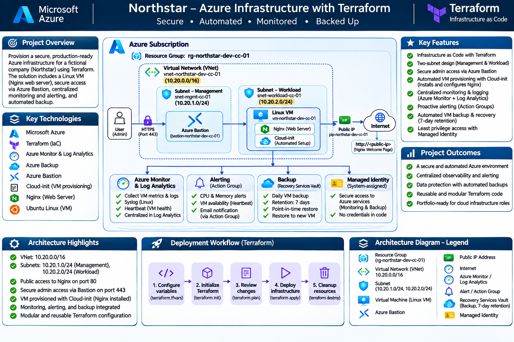
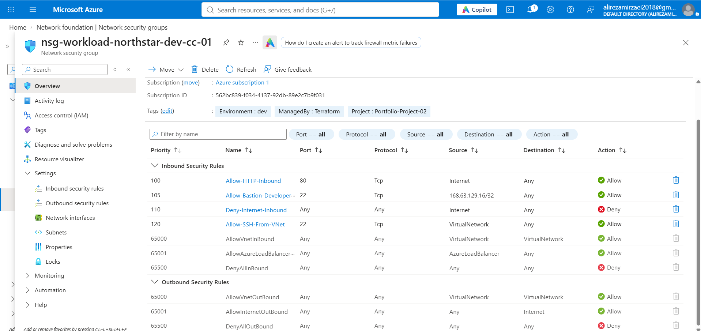
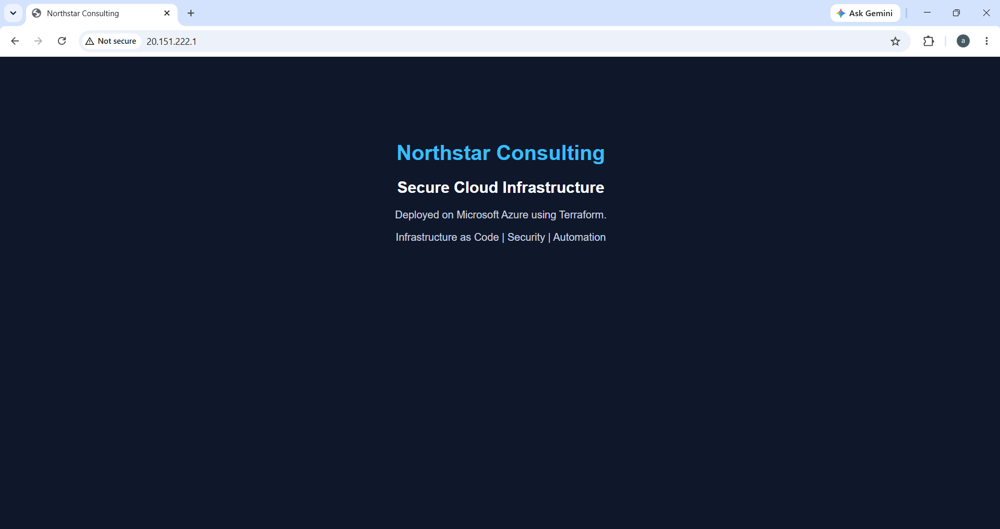
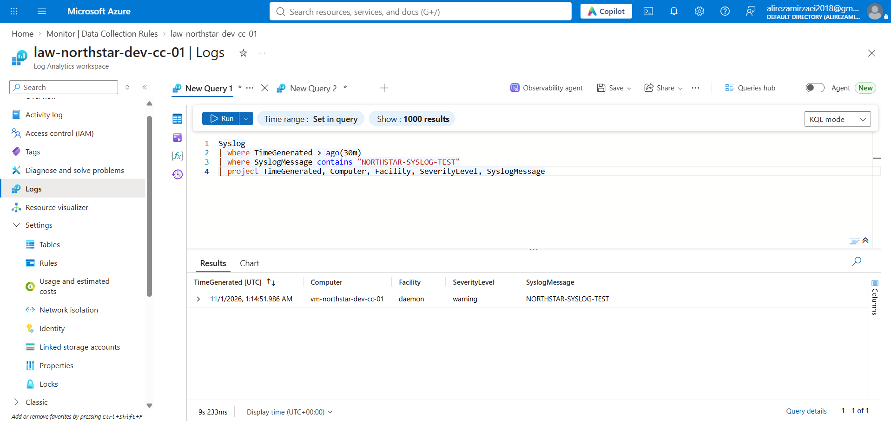
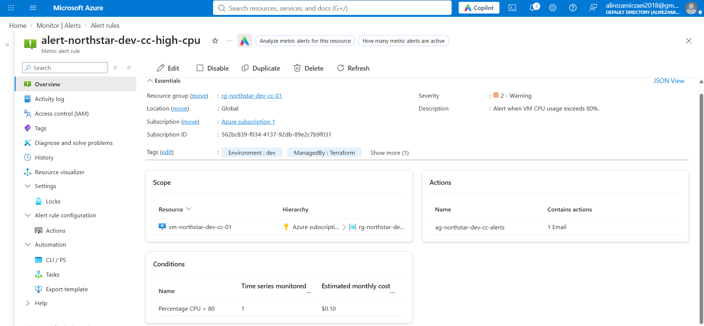
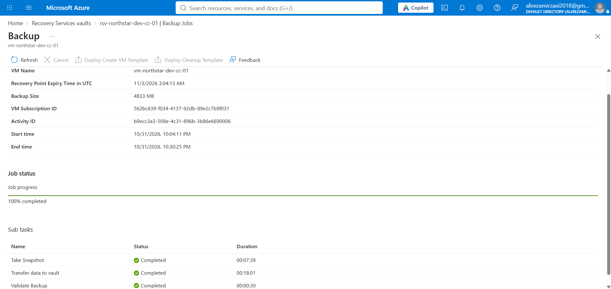
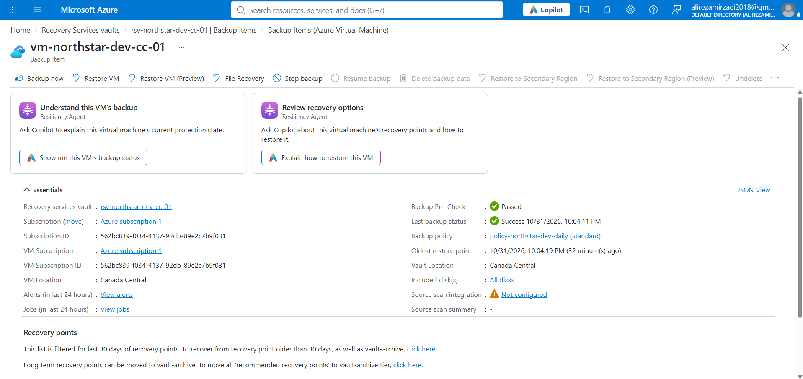

# Northstar Consulting — Azure Infrastructure with Terraform

**Infrastructure as Code | Secure networking | Automated Linux provisioning | Centralized monitoring | VM backup**

A hands-on Azure infrastructure portfolio project for a fictional consulting business, **Northstar Consulting**. The environment was provisioned with Terraform, validated in Azure, monitored using Azure Monitor Agent and Log Analytics, and protected with Azure Backup. Resources were subsequently decommissioned to control lab costs.

> **Project status:** Deployment, Syslog ingestion, Heartbeat, and a VM backup job were verified. CPU alert configuration and its email action group were deployed; an actual threshold breach and email delivery were **not** verified. A restore test was **not** performed. This is a learning/portfolio lab, not a production-ready reference architecture.

## Contents

1. [Business scenario and objectives](#business-scenario-and-objectives)
2. [Architecture](#architecture)
3. [Technology stack](#technology-stack)
4. [Infrastructure inventory](#infrastructure-inventory)
5. [Network and security design](#network-and-security-design)
6. [Automated deployment](#automated-deployment)
7. [Monitoring and alerting](#monitoring-and-alerting)
8. [Backup and recovery](#backup-and-recovery)
9. [Validation and evidence](#validation-and-evidence)
10. [Deployment instructions](#deployment-instructions)
11. [Cost management and teardown](#cost-management-and-teardown)
12. [Troubleshooting and lessons learned](#troubleshooting-and-lessons-learned)
13. [Limitations and next steps](#limitations-and-next-steps)
14. [Repository structure](#repository-structure)

## Business scenario and objectives

Northstar Consulting is a fictional organization requiring a small, reproducible Azure environment to host a public-facing demonstration website while keeping administrative access restricted and operations observable.

The project aims to demonstrate:

- Repeatable provisioning through **Terraform** rather than click-only portal deployment.
- Separation of management and application workloads at the **subnet** level.
- A Linux VM configured automatically using **cloud-init**.
- Network controls that expose the web application but do not broadly expose SSH.
- Centralized Linux Syslog ingestion and VM Heartbeat visibility.
- CPU metric alerting connected to an email **Action Group**.
- A daily VM backup policy and successful on-demand backup.
- Cost-conscious teardown after documenting the implementation.

## Architecture



> **Diagram accuracy note:** The repository's original infographic may contain illustrative or outdated labels. The **Terraform files and configuration tables below are the authoritative source**. In particular, the actual VNet is `10.20.0.0/16`, the management and workload subnets are `10.20.1.0/24` and `10.20.2.0/24`, and the configured backup retention is **7 days**, not 14. Only **CPU** alerting is implemented; memory and availability alerts are future enhancements. Azure Bastion Developer is a managed access service associated with the VNet, not a VM deployed inside the management subnet.

### High-level data flows

**Application traffic:** Internet → public IP → VM NIC → workload subnet / NSG → Nginx on TCP 80.

**Administrative access:** Azure Portal / Bastion Developer → private SSH access to the Linux VM, subject to the configured NSG rules.

**Observability:** Linux Syslog → rsyslog → Azure Monitor Agent (AMA) → Data Collection Rule (DCR) → Log Analytics Workspace.

**Alerting:** Azure VM `Percentage CPU` metric → Azure Monitor metric alert → Action Group → email recipient.

**Backup:** Azure VM → Recovery Services Vault, using a daily VM backup policy.

## Technology stack

| Component | Implementation |
|---|---|
| Cloud platform | Microsoft Azure, Canada Central |
| Infrastructure as Code | Terraform, `hashicorp/azurerm` provider (`~> 4.0`) |
| Operating system | Ubuntu Server 24.04 LTS |
| Compute | Azure Linux VM, default `Standard_B2s` |
| Web service | Nginx |
| Provisioning | cloud-init |
| Network | VNet, two subnets, NSG, Standard static public IP |
| Administrative access | Azure Bastion Developer, SSH public-key authentication |
| Identity | System-assigned managed identity on the VM |
| Monitoring | Azure Monitor Agent, Data Collection Rule, Log Analytics |
| Alerting | Azure Monitor CPU metric alert and email Action Group |
| Backup | Recovery Services Vault, Azure VM Backup |
| Evidence | Azure Portal screenshots and tested KQL queries |

## Infrastructure inventory

Terraform resource names are derived from the project/environment prefix (`northstar-dev-cc`).

| Azure resource | Example deployed name / configuration |
|---|---|
| Resource group | `rg-northstar-dev-cc-01` |
| VNet | `vnet-northstar-dev-cc-01` — `10.20.0.0/16` |
| Management subnet | `snet-management` — `10.20.1.0/24` |
| Workload subnet | `snet-workload` — `10.20.2.0/24` |
| Workload NSG | `nsg-workload-northstar-dev-cc-01` |
| Linux VM | `vm-northstar-dev-cc-01` |
| Public IP | `pip-northstar-dev-cc-vm-01` |
| Bastion | `bas-northstar-dev-cc-01` (Developer SKU) |
| Log Analytics Workspace | `law-northstar-dev-cc-01` |
| Linux DCR | `dcr-northstar-dev-cc-linux-01` |
| CPU metric alert | `alert-northstar-dev-cc-high-cpu` |
| Action Group | `ag-northstar-dev-cc-alerts` |
| Recovery Services Vault | `rsv-northstar-dev-cc-01` |
| VM backup policy | `policy-northstar-dev-daily` |

## Network and security design

The VNet uses a `10.20.0.0/16` address space with a dedicated management subnet and a workload subnet. The VM NIC is attached to the **workload** subnet. The management subnet is reserved for future management workloads; Azure Bastion Developer itself is not deployed into that subnet.

### Workload NSG rules

| Priority | Rule | Protocol / port | Source | Action |
|---|---|---|---|---|
| 100 | `Allow-HTTP-Inbound` | TCP 80 | Internet | Allow |
| 105 | `Allow-Bastion-Developer-SSH` | TCP 22 | `168.63.129.16/32` | Allow |
| 110 | `Deny-Internet-Inbound` | Any | Internet | Deny |
| 120 | `Allow-SSH-From-VNet` | TCP 22 | VirtualNetwork | Allow |

**Design decisions:** The public web service is deliberately accessible over HTTP for a simple lab demonstration. VM password authentication is disabled; Terraform configures an SSH public key. A system-assigned managed identity is enabled for the VM to support Azure integrations. Network rules are managed as code.

**Security caveats:** This is not a hardened production setup. HTTP traffic is unencrypted, the VM has a public IP, and the management subnet is not a separate security boundary by itself. Production improvements would include HTTPS/TLS, tighter exposure, documented RBAC, and more extensive security monitoring.



## Automated deployment

The VM uses `custom_data` to pass `cloud-init.yaml` at provisioning time. Cloud-init:

1. Updates package metadata.
2. Installs Nginx.
3. Writes a branded Northstar HTML page to `/var/www/html/index.html`.
4. Enables and restarts the Nginx service.

This removes the need to manually configure the web server after each deployment.



### Why Terraform?

Terraform makes the environment reproducible, versionable, and reviewable. The code separates network, compute, monitoring, alerting, backup, and access resources into logical files while Terraform resolves dependencies across those files.

## Monitoring and alerting

### Log Analytics and Syslog

The Terraform configuration deploys:

- A Log Analytics Workspace with **30-day retention** and a configured daily ingestion quota of **0.1 GB**.
- Azure Monitor Agent as a Linux VM extension.
- A Linux Data Collection Rule associated with the VM.
- Syslog collection for `auth`, `authpriv`, `daemon`, and `syslog`.
- Severity levels `Warning`, `Error`, `Critical`, `Alert`, and `Emergency`.

A live test event was generated from Ubuntu:

```bash
logger -p daemon.warning "NORTHSTAR-SYSLOG-TEST"
```

The test event was successfully retrieved from Log Analytics:

```kusto
Syslog
| where TimeGenerated > ago(30m)
| where SyslogMessage contains "NORTHSTAR-SYSLOG-TEST"
| project TimeGenerated, Computer, Facility, SeverityLevel, SyslogMessage
```

The result identified the Northstar VM, facility `daemon`, severity `warning`, and the exact test message. VM Heartbeat ingestion was also observed.



### CPU alert

The VM-level Azure Monitor metric alert is configured as follows:

| Setting | Value |
|---|---|
| Metric | `Percentage CPU` |
| Namespace | `Microsoft.Compute/virtualMachines` |
| Aggregation | Average |
| Operator | Greater than |
| Threshold | 80% |
| Evaluation frequency | 5 minutes |
| Window size | 5 minutes |
| Severity | 2 — Warning |
| Notification | Email receiver in Action Group |

The Action Group is connected to the alert using Terraform. **A real CPU threshold breach and receipt of the notification email were not validated** during this lab.



## Backup and recovery

The environment uses Azure VM Backup with:

- **Recovery Services Vault:** Standard SKU.
- **Vault storage redundancy:** Locally redundant (`LocallyRedundant`).
- **Policy frequency:** Daily.
- **Scheduled time:** 23:00, `Eastern Standard Time` time-zone identifier.
- **Daily retention:** **7 days**.
- **Protected item:** Northstar Ubuntu VM.

An **on-demand VM backup job completed successfully**, and a Recovery Point was visible in the Azure Portal. Screenshots capture both outcomes. A restore operation was **not** performed, so recovery success is not claimed.

After documenting the backup, protection was stopped and backup data deletion was requested. Azure displayed the recovery points in **soft-deleted** state; this is expected and must be considered when decommissioning a vault.





## Validation and evidence

| Test / validation | Result | Evidence |
|---|---|---|
| Terraform configuration validation | Passed during development | CLI |
| Azure VM deployment | Verified | [VM](screenshots/VM.png) |
| VNet and subnet configuration | Verified | [VNet](screenshots/vnet.png), [Subnets](screenshots/subnet.png) |
| NSG rules | Verified | [NSG](screenshots/NSG.png) |
| Nginx website | Verified | [Web page](screenshots/web-page.png) |
| Azure Monitor Agent installed | Verified | [Extension](screenshots/Extension.png) |
| VM Heartbeat | Observed | Log Analytics |
| Custom Syslog event ingestion | Passed | [Log Analytics](screenshots/Log-analytics.png) |
| CPU alert and Action Group configuration | Deployed | [Alert](screenshots/Alert.png) |
| CPU alert firing and email delivery | Not tested | — |
| On-demand Azure VM backup | Completed | [Backup job](screenshots/backup-job.png) |
| Recovery Point created | Verified | [Recovery point](screenshots/Recovery-point.png) |
| VM restore | Not tested | — |

Additional screenshots: [Resource Group](screenshots/01-resource-group.png) and [Azure Bastion](screenshots/Bastion.png).

## Deployment instructions

### Prerequisites

- An Azure subscription with permissions to create the required resources.
- Azure CLI authenticated to the intended tenant/subscription.
- Terraform version `>= 1.5.0`.
- An SSH key pair; only the **public** key is referenced by Terraform.
- An email address to receive Azure Monitor alerts.
- Awareness of the Azure costs associated with VMs, public IPs, disks, Log Analytics, and Backup.

### 1. Clone the repository

```bash
git clone https://github.com/YOUR_USERNAME/azure-infrastructure-terraform.git
cd azure-infrastructure-terraform
```

Replace `YOUR_USERNAME` with your GitHub username.

### 2. Authenticate

```bash
az login
az account set --subscription "YOUR_SUBSCRIPTION_ID"
```

### 3. Configure variables

Copy `terraform.tfvars.example` to `terraform.tfvars` and replace the placeholders with your own values:

```hcl
subscription_id    = "YOUR_SUBSCRIPTION_ID"
location           = "canadacentral"
project_name       = "northstar"
environment        = "dev"
vm_size            = "Standard_B2s"
admin_username     = "azureadmin"
ssh_public_key_path = "PATH_TO_YOUR_PUBLIC_SSH_KEY"
alert_email        = "YOUR_EMAIL@example.com"
```

> `terraform.tfvars` must remain local and **must not** be committed. The public SSH key file must exist at the specified path. Never commit a private SSH key.

### 4. Initialize, validate, plan, and deploy

```bash
terraform init
terraform fmt -check
terraform validate
terraform plan -out=deployment.tfplan
terraform apply deployment.tfplan
```

Terraform will deploy the resources defined in the repository, including the VM, monitoring, alerting, and backup configuration. **Creating the backup policy does not guarantee an immediate completed backup**; use the Azure Portal to trigger and inspect an on-demand backup if required.

### 5. Verify deployment

```bash
terraform output
```

Check the website using the VM public IP; verify the monitoring configuration in Log Analytics; and review the Recovery Services Vault if testing Backup.

> **Cost warning:** Running these commands creates billable Azure resources. Review the plan and expected charges before applying.

## Cost management and teardown

This project was designed as a temporary portfolio lab. Use Azure Cost Management to inspect consumption by resource group and resource.

Before teardown:

1. Capture evidence required for the portfolio.
2. Stop backup protection and request deletion of backup data.
3. Review **soft-deleted** backup items and any vault protection settings.
4. Run `terraform plan -destroy` to inspect the intended deletion.
5. Run `terraform destroy` only after confirming that no needed resources or data will be lost.
6. Confirm resource deletion in Azure Portal and Cost Management; a Recovery Services Vault may require additional cleanup due to backup protection and soft-delete behavior.

```bash
terraform plan -destroy
terraform destroy
```

**Do not assume that deleting a resource group automatically removes every retained backup artifact or all charges.** Verify the final state. Terraform source files remain on the local machine after `terraform destroy`.

## Troubleshooting and lessons learned

The most significant operational challenge was **Syslog data not appearing in Log Analytics** even though the Linux logging pipeline was forwarding events locally.

Investigation included checking the AMA extension and service, DCR association and cache, rsyslog forwarding, agent logs, managed identity token retrieval, and Log Analytics queries. The VM's Heartbeat also temporarily stopped. After reinstalling Azure Monitor Agent and verifying the data pipeline, Heartbeat resumed and a newly generated `daemon.warning` test event appeared in the `Syslog` table.

**What was demonstrated:** diagnosing an observability pipeline end-to-end, distinguishing a local log-forwarding success from cloud ingestion success, and validating the fix with a new event rather than relying only on old log records.

**What was not established:** a definitive root cause for the original ingestion interruption. Reinstalling the agent was part of the recovery, but the evidence does not isolate a single causal fault.

Other lessons:

- `terraform plan` identifies drift after manual portal operations; the agent reinstall caused a tag-only update in one plan.
- Terraform resource references must match the **actual local resource names**, such as `azurerm_linux_virtual_machine.vm.id`.
- Provider schemas evolve: `storage_mode_type` was used for the vault, and a deprecated `soft_delete_enabled` argument was removed.
- A completed backup job demonstrates backup creation; **restore verification** requires a separate test.

## Limitations and next steps

This project intentionally favors a manageable learning scope and budget over production completeness. Future improvements include:

- HTTPS/TLS for the web application, optionally through a reverse proxy or application gateway.
- Tighter network access and private-only workload designs.
- Additional alert rules for VM availability and memory (where supported by collected metrics).
- A tested recovery procedure, including an actual restore and documented recovery objectives.
- Terraform CI checks, formatting/validation in GitHub Actions, and automated security scanning.
- Remote Terraform state with appropriate access controls and locking.
- More granular role-based access and identity governance.
- Infrastructure cost estimates and budget alerts.

## Repository structure

```text
azure-infrastructure-terraform/
├── .gitignore
├── .terraform.lock.hcl
├── README.md
├── main.tf
├── providers.tf
├── variables.tf
├── terraform.tfvars.example
├── outputs.tf
├── compute.tf
├── cloud-init.yaml
├── public-ip.tf
├── bastion.tf
├── monitoring.tf
├── alerts.tf
├── backup.tf
└── screenshots/
    ├── architecture-diagram.png
    ├── 01-resource-group.png
    ├── VM.png
    ├── vnet.png
    ├── subnet.png
    ├── NSG.png
    ├── Bastion.png
    ├── Extension.png
    ├── Log-analytics.png
    ├── Alert.png
    ├── web-page.png
    ├── backup-job.png
    └── Recovery-point.png
```

**Never publish** `.terraform/`, `terraform.tfstate`, `terraform.tfstate.backup`, `terraform.tfvars`, saved `.tfplan` files, private keys, or other secrets. Review screenshots for account information, subscription IDs, tenant IDs, and sensitive metadata before publishing.

---

**Project type:** Independent Azure infrastructure / Terraform portfolio lab  
**Organization:** Northstar Consulting (fictional)  
**Primary focus:** Cloud infrastructure, automation, observability, and operational validation
